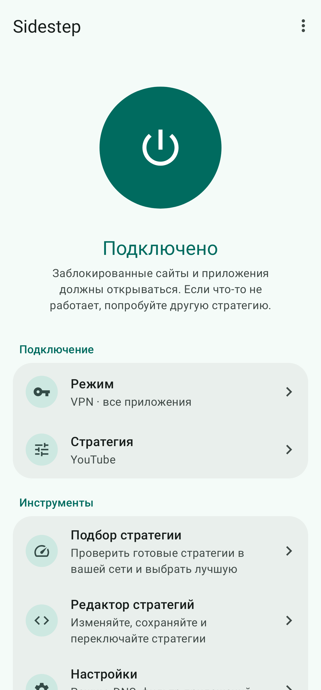
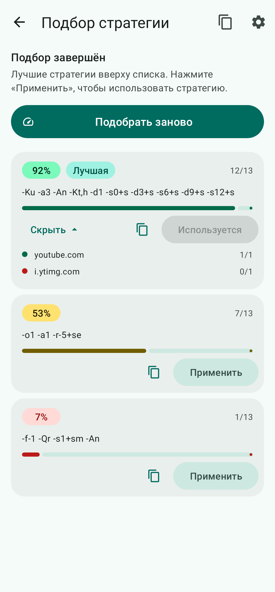
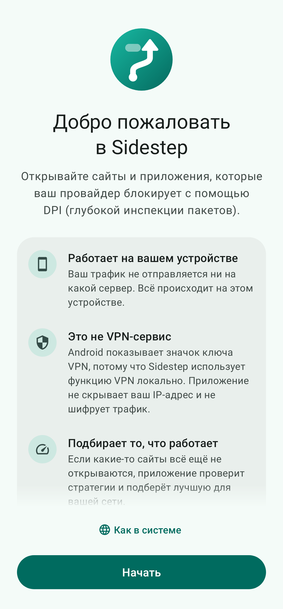

<div align="center">
  <p>
    
  </p>
  <h1>Sidestep</h1>
  <p>
    <a href="README.md">English</a> |
    Русский |
    <a href="README-tr.md">Türkçe</a>
  </p>
  <p>
    <a href="https://github.com/metetv2021-cloud/ByeByeDPI/actions/workflows/build.yml"></a>
    <a href="LICENSE"></a>
  </p>
</div>

Sidestep открывает сайты и приложения, которые ваш провайдер блокирует с помощью DPI (глубокого анализа трафика). Приложение запускает [ByeDPI](https://github.com/hufrea/byedpi) прямо на телефоне или телевизоре и пропускает трафик через него.

Sidestep — не VPN-сервис. Он использует функцию VPN в Android, чтобы перенаправлять трафик внутри устройства, но ничего не отправляет на удалённый сервер. Приложение не шифрует трафик и не скрывает ваш IP-адрес.

Sidestep — переработанный форк [ByeByeDPI](https://github.com/romanvht/ByeByeDPI) от romanvht.

<p align="center">
  
  
  
</p>

---

### Возможности

* **Одна кнопка.** Нажмите, чтобы подключиться. Экран подскажет, что происходит и что делать дальше.
* **Сам находит рабочий вариант.** Подбор стратегии проверяет готовые стратегии на выбранных сайтах, оценивает каждую и позволяет применить лучшую одним нажатием.
* **Сохранённые стратегии.** Переключайте стратегии прямо с главного экрана. Закрепляйте, переименовывайте и редактируйте их в редакторе стратегий.
* **Заблокированные приложения.** Sidestep определяет, в какой вы стране, и показывает приложения, которые там заблокированы. Он устанавливает их с официальных сайтов разработчиков или из F-Droid либо открывает их в Google Play или Aurora Store. Ничего не скачивается, пока вы не нажмёте кнопку.
* **Для новичков и опытных.** Настраивайте стратегию в визуальном редакторе или пишите аргументы командной строки ByeDPI сами.
* **VPN или прокси.** Режим VPN работает для всех приложений, для всех, кроме выбранных, или только для выбранных. Режим прокси даёт локальный SOCKS5-прокси для отдельных приложений.
* **Запускается сам.** Подключение при включении устройства или при открытии приложения. Плитка в быстрых настройках и ярлыки на рабочем столе для закреплённых стратегий.
* **Android TV.** Работает на телевизорах и ТВ-приставках с пультом.
* **18 языков.** Английский, арабский, азербайджанский, белорусский, вьетнамский, испанский, индонезийский, казахский, китайский (упрощённый), немецкий, персидский, португальский (Бразилия), русский, турецкий, узбекский, украинский, французский и хинди.
* **Выглядит современно.** Светлая и тёмная темы, а на Android 12 и новее — цвета из ваших обоев.
* **Резервная копия.** Экспорт и импорт настроек, стратегий, списков приложений и доменов. Можно импортировать и копии, сделанные в ByeByeDPI.

### Как начать

1. Установите приложение и откройте его. На приветственном экране можно выбрать язык.
2. Нажмите **Подключить** и разрешите запрос VPN. Android покажет его только в первый раз.
3. Если какие-то сайты всё ещё не открываются, откройте **Подбор стратегии** и нажмите **Начать подбор**. Когда проверка закончится, нажмите **Применить** у стратегии в начале списка.

Чтобы приложение запускалось после перезагрузки, включите **Настройки → Запускать при включении устройства**. Перед этим подключитесь один раз вручную, чтобы Android запомнил разрешение на VPN.

На некоторых устройствах Android закрывает фоновые приложения ради экономии заряда. Если соединение пропадает, разрешите приложению работать без ограничений батареи (приложение предложит это после первого подключения).

Настройка ТВ-приставок Сбер: [sbox.md](sbox.md).

### Переход с ByeByeDPI

У Sidestep свой идентификатор приложения, поэтому он устанавливается рядом с ByeByeDPI, а не вместо него. Чтобы сохранить настройки, экспортируйте их в ByeByeDPI (Настройки → меню ⋮ → Экспорт настроек) и импортируйте файл в Sidestep (Настройки → Импорт настроек). Android позволяет работать только одному VPN одновременно, поэтому держите подключённым только одно из приложений.

### Сборка

Нужны JDK 17 или новее и Android SDK с NDK 27.0.12077973 и CMake 3.22.1. Нативный код не собирается под Windows: используйте Linux, macOS или WSL.

1. Клонируйте репозиторий вместе с сабмодулями:

```bash
git clone --recurse-submodules https://github.com/metetv2021-cloud/ByeByeDPI.git
```

2. Запустите сборку из корня репозитория:

```bash
./gradlew assembleDebug
```

3. APK появятся в `app/build/outputs/apk/debug/`. Для каждого типа процессора есть свой APK, а также универсальный, который подходит для всех устройств.

`./gradlew assembleRelease` собирает более компактные оптимизированные APK. Они не подписаны: подпишите их своим ключом с помощью `apksigner`.

Каждый push в этот репозиторий также собирается в GitHub Actions. Отладочные APK можно скачать в разделе **Artifacts** нужного запуска.

### Как обновлять список заблокированных приложений

Список находится в `app/src/main/assets/blocked_apps.json`. Для каждого приложения указаны названия пакетов, официальный сайт, способ загрузки (`apk`, `json`, `fdroid` или `page`, необязательно) и страны, где оно заблокировано (`blocked`) или ограничено (`restricted`). После правки поменяйте `updated` на сегодняшнюю дату и отправьте изменения в ветку `master`: приложение загрузит новый список, когда пользователь нажмёт **Обновить список**. Ради безопасности скачивать можно только с сайтов из `trustedHosts` в `AppCatalogUtils.kt`, поэтому новый сайт для загрузки требует обновления приложения.

### Переводы

Английские тексты находятся в `app/src/main/res/values/strings.xml`, а у каждого языка есть свой файл `values-<код>/strings.xml`. Переводы сделаны с помощью машинного перевода, поэтому исправления от носителей языка очень приветствуются.

### Благодарности

Sidestep основан на работе этих проектов с открытым исходным кодом:

* [ByeByeDPI](https://github.com/romanvht/ByeByeDPI) от [romanvht](https://github.com/romanvht) — приложение, на котором основан этот форк
* [ByeDPIAndroid](https://github.com/dovecoteescapee/ByeDPIAndroid) от [dovecoteescapee](https://github.com/dovecoteescapee) — исходное приложение для Android
* [ByeDPI](https://github.com/hufrea/byedpi) от [hufrea](https://github.com/hufrea) — движок для обхода DPI
* [hev-socks5-tunnel](https://github.com/heiher/hev-socks5-tunnel) от [heiher](https://github.com/heiher) — соединяет VPN с прокси

### Лицензия

[GNU General Public License v3.0](LICENSE), как и у проектов выше.
