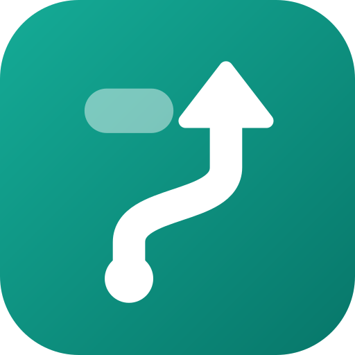
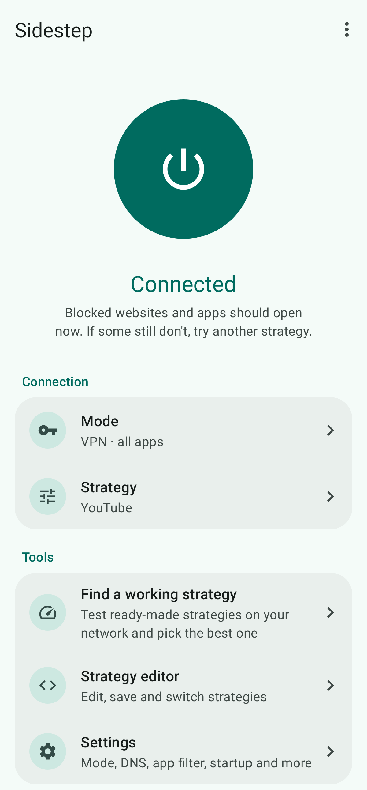
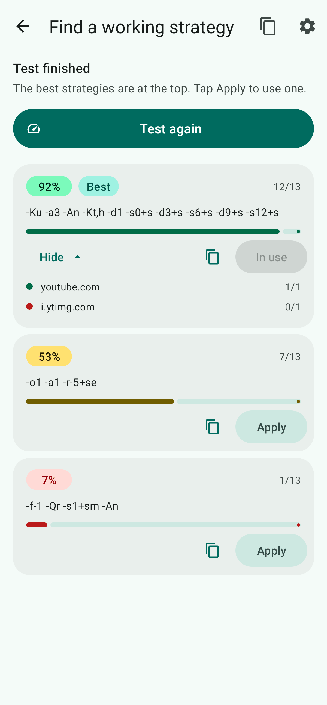
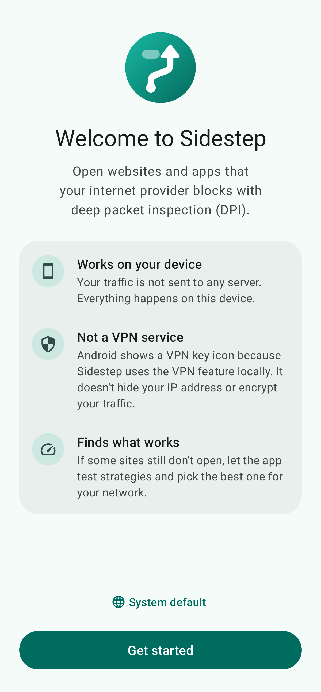

<div align="center">
  <p>
    
  </p>
  <h1>Sidestep</h1>
  <p>
    <a href="README.md">English</a> |
    <a href="README-ru.md">Русский</a> |
    Türkçe
  </p>
  <p>
    <a href="https://github.com/metetv2021-cloud/ByeByeDPI/actions/workflows/build.yml"></a>
    <a href="LICENSE"></a>
  </p>
</div>

Sidestep, internet sağlayıcınızın DPI (derin paket incelemesi) ile engellediği siteleri ve uygulamaları açar. [ByeDPI](https://github.com/hufrea/byedpi)’yi telefonunuzda veya televizyonunuzda çalıştırır ve trafiğinizi onun üzerinden geçirir.

Sidestep bir VPN hizmeti değildir. Trafiği cihaz içinde yönlendirmek için Android’in VPN özelliğini kullanır, ancak hiçbir veriyi uzak bir sunucuya göndermez. Trafiğinizi şifrelemez ve IP adresinizi gizlemez.

Sidestep, romanvht’nin geliştirdiği [ByeByeDPI](https://github.com/romanvht/ByeByeDPI) uygulamasının yeniden tasarlanmış bir çatalıdır.

<p align="center">
  
  
  
</p>

---

### Özellikler

* **Tek düğme.** Bağlanmak için dokunun. Ekran ne olduğunu ve sırada ne yapmanız gerektiğini söyler.
* **Çalışanı kendisi bulur.** Strateji bulucu, hazır stratejileri seçtiğiniz sitelerde dener, her birine puan verir ve en iyisini tek dokunuşla uygulamanızı sağlar.
* **Kayıtlı stratejiler.** Stratejileri ana ekrandan değiştirin. Strateji düzenleyicide sabitleyin, yeniden adlandırın ve düzenleyin.
* **Yeni başlayanlar ve uzmanlar için.** Görsel düzenleyiciyi kullanın ya da ByeDPI komut satırı argümanlarını kendiniz yazın.
* **VPN veya proxy.** VPN modu tüm uygulamalar, seçtikleriniz dışındaki tüm uygulamalar veya yalnızca seçtikleriniz için çalışır. Proxy modu, tek tek uygulamalar için yerel bir SOCKS5 proxy sunar.
* **Kendiliğinden başlar.** Cihaz açıldığında veya uygulamayı açtığınızda bağlanır. Hızlı ayarlar kutucuğu ve sabitlenmiş stratejiler için ana ekran kısayolları.
* **Android TV.** Televizyonlarda ve TV kutularında kumandayla çalışır.
* **18 dil.** Almanca, Arapça, Azerbaycanca, Belarusça, Çince (Basitleştirilmiş), Endonezce, Farsça, Fransızca, Hintçe, İngilizce, İspanyolca, Kazakça, Portekizce (Brezilya), Rusça, Türkçe, Ukraynaca, Özbekçe ve Vietnamca.
* **Göze hoş görünür.** Açık ve koyu tema; Android 12 ve sonrasında duvar kâğıdınızdan gelen renkler.
* **Yedekleme.** Ayarları, stratejileri, uygulama listelerini ve alan adı listelerini dışa ve içe aktarın. ByeByeDPI ile alınan yedekler de içe aktarılabilir.

### Başlarken

1. Uygulamayı yükleyin ve açın. Karşılama ekranında dili seçebilirsiniz.
2. **Bağlan**’a dokunun ve VPN isteğine izin verin. Android bunu yalnızca ilk seferde sorar.
3. Bazı siteler hâlâ açılmıyorsa **Çalışan strateji bul**’a gidin ve **Testi başlat**’a dokunun. Test bitince listenin en üstündeki stratejide **Uygula**’ya dokunun.

Yeniden başlatmadan sonra otomatik başlaması için **Ayarlar → Cihaz açıldığında başlat** seçeneğini açın. Android’in VPN iznini hatırlaması için önce bir kez elle bağlanın.

Bazı cihazlarda Android, pil tasarrufu için arka plandaki uygulamaları durdurur. Bağlantı kesiliyorsa uygulamanın pil kısıtlaması olmadan çalışmasına izin verin (uygulama bunu ilk bağlantıdan sonra önerir).

### ByeByeDPI’dan geçiş

Sidestep’in kendi uygulama kimliği vardır; bu yüzden ByeByeDPI’ın yerine değil, yanına kurulur. Ayarlarınızı korumak için ByeByeDPI’da dışa aktarın (Ayarlar → ⋮ menüsü → Ayarları Dışa Aktar) ve dosyayı Sidestep’te içe aktarın (Ayarlar → Ayarları içe aktar). Android aynı anda yalnızca bir VPN çalıştırır, bu yüzden ikisinden yalnızca birini bağlı tutun.

### Derleme

JDK 17 veya üstü ve NDK 27.0.12077973 ile CMake 3.22.1 içeren Android SDK gerekir. Yerel kod Windows’ta derlenmez; Linux, macOS veya WSL kullanın.

1. Depoyu alt modülleriyle birlikte klonlayın:

```bash
git clone --recurse-submodules https://github.com/metetv2021-cloud/ByeByeDPI.git
```

2. Deponun kök dizininden derleyin:

```bash
./gradlew assembleDebug
```

3. APK dosyaları `app/build/outputs/apk/debug/` dizinindedir. Her işlemci türü için ayrı bir APK ve her cihazda çalışan evrensel bir APK bulunur.

`./gradlew assembleRelease` daha küçük ve optimize edilmiş APK’lar derler. Bunlar imzasızdır; `apksigner` ile kendi anahtarınızla imzalayın.

Bu depoya yapılan her push GitHub Actions’ta da derlenir. Hata ayıklama APK’larını ilgili çalıştırmanın **Artifacts** bölümünden indirebilirsiniz.

### Çeviriler

İngilizce metinler `app/src/main/res/values/strings.xml` dosyasındadır; her dilin kendi `values-<kod>/strings.xml` dosyası vardır. Çeviriler makine çevirisi yardımıyla yapıldı; ana dili konuşanlardan gelecek düzeltmeler memnuniyetle karşılanır.

### Teşekkürler

Sidestep şu açık kaynak projelerin emeği üzerine kuruludur:

* [romanvht](https://github.com/romanvht) tarafından [ByeByeDPI](https://github.com/romanvht/ByeByeDPI): bu çatalın dayandığı uygulama
* [dovecoteescapee](https://github.com/dovecoteescapee) tarafından [ByeDPIAndroid](https://github.com/dovecoteescapee/ByeDPIAndroid): ilk Android uygulaması
* [hufrea](https://github.com/hufrea) tarafından [ByeDPI](https://github.com/hufrea/byedpi): DPI’ı aşan motor
* [heiher](https://github.com/heiher) tarafından [hev-socks5-tunnel](https://github.com/heiher/hev-socks5-tunnel): VPN’i proxy’ye bağlar

### Lisans

Yukarıdaki projelerle aynı şekilde [GNU General Public License v3.0](LICENSE).
